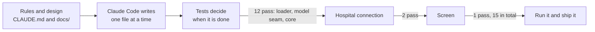

# CityForward POC: starter pack for building with Claude Code

The starting point for a proof of concept built live with Claude Code: a **patient-history summarizer** that reads one synthetic patient's chart through a hospital's FHIR interface and writes a short summary in which every statement cites its source. Code checks every citation and number, and a labelled template appears instead of anything unchecked.

> **All data in this repository is synthetic.** No real person appears in any file.

## This repository holds the starting point only

The application code is **not here on purpose**. It is written step by step with Claude Code, and the tests in this folder are what that code has to pass. Running the tests now fails, and that is expected.



## What is in the starting folder

| Path | What it is | Why it is here |
|---|---|---|
| `CLAUDE.md` | The agent's standing rules, read automatically by Claude Code | Synthetic data only, follow the design, never edit the tests, build nothing extra, never show an unchecked summary, no secrets in git |
| `docs/01_POC_REQUIREMENTS.md` | The client's requirements and how they will judge it | What counts as success |
| `docs/02_POC_HLD.md` | The high-level design, with diagrams | What the POC is and is not |
| `docs/03_POC_LLD.md` | The low-level design: every file, function, message and the model prompt | The contract Claude builds to |
| `docs/04_EHR_FHIR_NOTES.md` | How the hospital's FHIR interface behaves, with the token sequence | What Claude cannot guess |
| `poc/tests/` | 15 acceptance tests | The definition of done. They are fixed and must not be edited |
| `sample_data/bundles/` | 22 synthetic patient files (19 generated with Synthea, 3 hand-written) | The input the POC reads |
| `scripts/verify.sh` | Runs the tests in stages with a clean environment | Same result on every machine |
| `scripts/make_keypair.py` | Creates the key pair for the read-only hospital client | The private key stays on your machine; only the public file is shared |
| `.env.example` | A template of settings | Copy to `.env`; `.env` is git-ignored |
| `.gitignore` | Keeps `.env`, keys, caches and the virtual environment out of git | A guard against committing a secret |

## The files Claude will create

`poc/summarizer/records.py`, `llm.py`, `graph.py`, `fhir.py`, `poc/app.py`, `poc/requirements.txt` and `poc/README.md`. Their names and contents are specified in `docs/03_POC_LLD.md`.

## The test stages

```bash
bash scripts/verify.sh engine   # 12 tests: records, model seam and graph
bash scripts/verify.sh fhir     # 2 tests: the hospital client
bash scripts/verify.sh app      # 1 test: the screen
bash scripts/verify.sh          # all 15
```

Python 3.11 or newer is needed once the code exists.

## Branches

`main` and `initial-setup` hold this starting point. Later work is added on top, one step at a time.
