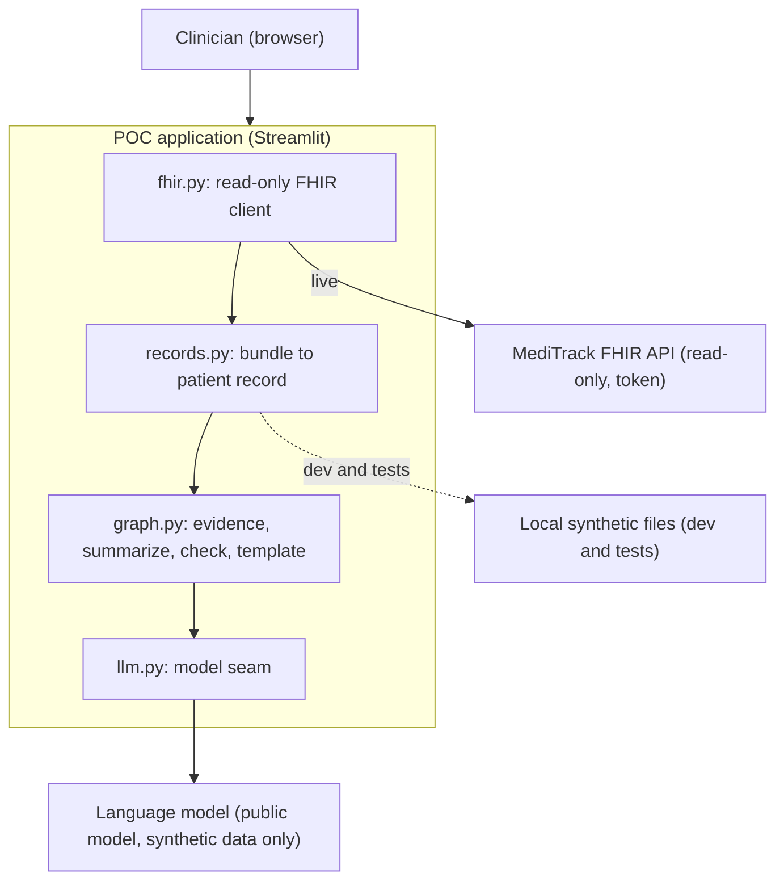
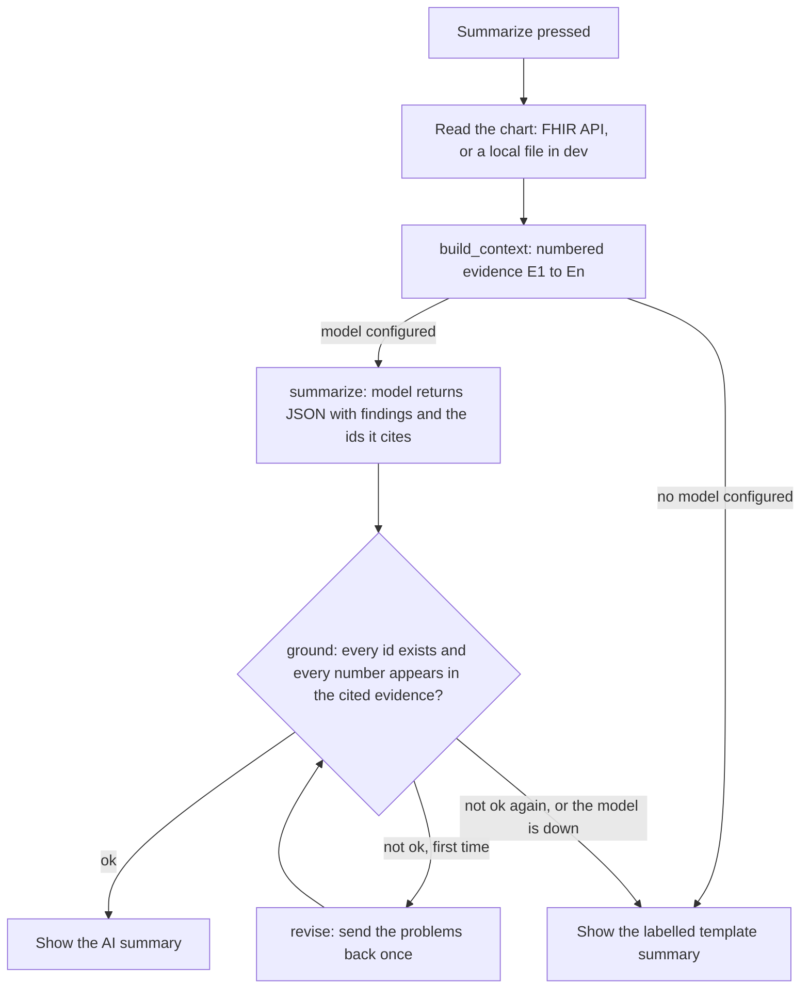

# POC high-level design

## 1. What it is

A small Streamlit application that lets a clinician pick a synthetic patient, press **Summarize**, and read a short, cited summary of the stay plus the evidence it was built from. It reads the chart through the hospital's FHIR interface, asks a language model to write the summary, and checks the result before showing it.

## 2. Context

In development and in the tests, the same code reads local synthetic files (`sample_data/bundles`) instead of the FHIR API.

## 3. Components

| Component | Responsibility | Does not do |
|---|---|---|
| **App** (`app.py`) | Patient picker, Summarize button, shows the result, the evidence and how long it took | No login, no storage, no editing of the chart |
| **FHIR client** (`fhir.py`) | Gets a short-lived read-only token and reads one patient's chart (and note text) from the EHR | Never writes; never follows a URL taken from the record |
| **Records** (`records.py`) | Turns a FHIR bundle into a plain typed patient record | No AI; deterministic |
| **Evidence builder** (in `graph.py`) | Picks the facts worth showing and numbers them `E1`, `E2`, ... | Does not paraphrase |
| **Summarizer graph** (`graph.py`) | Asks the model for a summary that cites evidence ids, checks it, retries once, else falls back | Never shows an unchecked summary |
| **Model seam** (`llm.py`) | One function: `complete_json(system, user)` for whichever model is configured | No model-specific logic elsewhere |

## 4. The main flow

Why a graph and not one prompt: the **checking is code**. The model writes; ordinary Python verifies. That is how "nothing is invented" is enforced rather than hoped for.

## 5. Trust boundaries

- The **private key** for the EHR client stays on the machine running the POC. The EHR stores only the public key.
- **Patient data goes to the model**, so only synthetic data is allowed in this POC.
- The POC **never writes** to the EHR.

## 6. Design decisions

| Decision | Reason |
|---|---|
| Read through FHIR, not the database | The client allows only the supported interface |
| The model returns JSON with citations | So each statement can be traced and checked |
| Numbers are checked against the cited evidence | The most damaging kind of invented fact is a wrong number |
| One retry, then a template | A bounded cost, and a fallback that is always safe |
| Template summary when no model is configured | The app works offline and proves the fallback |
| Provider chosen by environment, not in the screen | The client controls which model is used |

## 7. What the POC deliberately does not have

Login, audit trail, ward-level access control, removal of identifiers before the model call, retrieval over long charts, prior-authorization or coding features, and deployment into the hospital's cluster. Each is a later stage.

## 8. Risks

| Risk | Mitigation |
|---|---|
| The model invents a fact | Grounding check, one retry, labelled template |
| A long chart does not fit the prompt | Evidence is capped (counts and text length per kind) |
| The EHR token expires mid-run | Token cached, refreshed 30 seconds early, one retry on 401 |
| Wrong model settings | Provider and model come from environment variables; the model name is shown on the result |
