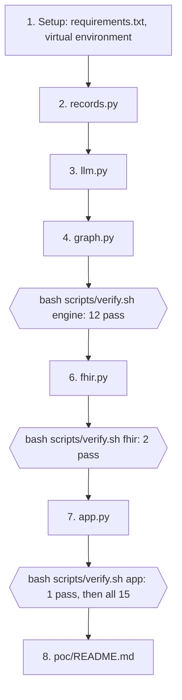
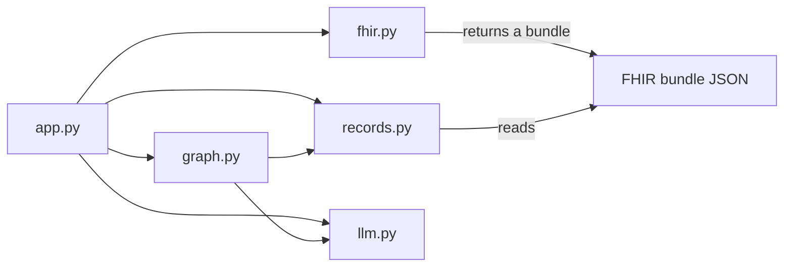
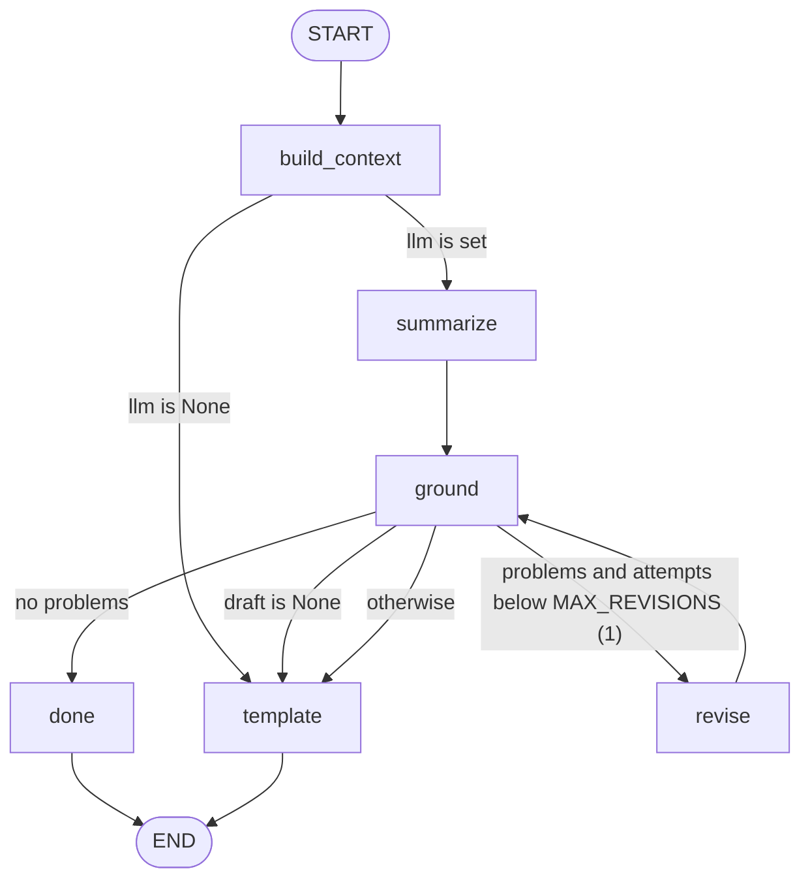

# POC low-level design (the contract)

Everything here is binding: file names, function names, field names, messages and the model prompt. The tests in `poc/tests/` check them.

## 0. Build order

1. Project setup (section 1)
2. `summarizer/records.py` (section 3)
3. `summarizer/llm.py` (section 4)
4. `summarizer/graph.py` (section 5)
5. `bash scripts/verify.sh engine`: **12 tests pass** (the FHIR client and the screen do not exist yet)
6. `summarizer/fhir.py` (section 6); `bash scripts/verify.sh fhir`: **2 tests pass**
7. `app.py` (section 7); `bash scripts/verify.sh app`: **1 test passes**; then `bash scripts/verify.sh`: **all 15 pass**
8. `poc/README.md` (section 9)

How the steps and checks fit together:



How the files depend on each other:



## 1. Setup

`poc/requirements.txt` (exactly these lines):

```
streamlit>=1.40
langgraph>=1.0
langchain-core>=1.0
langchain-openai>=1.0
pydantic>=2.8
python-dotenv
pytest
httpx
pyjwt[crypto]
```

Python 3.11 or newer. Tests run from the project root as `PYTHONPATH=poc python -m pytest poc/tests` (use `bash scripts/verify.sh`).

Environment variables (see `.env.example`): `LLM_PROVIDER`, `GROQ_API_KEY`, `LLM_BASE_URL`, `LLM_API_KEY`, `LLM_MODEL`, `POC_EHR_URL`, `POC_EHR_PUBLIC_URL`, `POC_FHIR_CLIENT_ID`, `POC_FHIR_KEY_FILE`, `BUNDLES_DIR`.

## 2. Data shapes (pydantic v2 `BaseModel`s in `records.py`)

| Model | Fields (name: type = default) |
|---|---|
| `Encounter` | `id: str`, `cls: str` (IMP, EMER, AMB, HH, VR), `type: str`, `start: str`, `end: str \| None = None`, `reason: str \| None = None`, `practitioner: str \| None = None` |
| `Condition` | `id: str`, `display: str`, `icd10: str \| None`, `snomed: str \| None`, `onset: str \| None`, `encounter: str \| None` |
| `Observation` | `id: str`, `name: str`, `loinc: str \| None`, `value: float \| None`, `unit: str = ""`, `date: str`, `category: str` (`laboratory` or `vital-signs`), `status: str = "final"`, `flag: str = ""` (H or L), `encounter: str \| None` |
| `Medication` | `id: str`, `name: str`, `rxnorm: str \| None`, `status: str`, `authored: str \| None`, `sig: str = ""`, `encounter: str \| None` |
| `Procedure` | `id: str`, `name: str`, `snomed: str \| None`, `date: str \| None`, `encounter: str \| None` |
| `Note` | `id: str`, `date: str`, `author: str = ""`, `kind: str = ""`, `text: str`, `encounter: str \| None` |
| `PatientRecord` | `patient_id`, `name`, `given`, `birth_date`, `sex`, `mrn \| None`, `city = ""`, `payer \| None`, and lists `encounters`, `conditions`, `observations`, `medications`, `procedures`, `notes` (each `Field(default_factory=list)`) |

`PatientRecord` properties and methods:

- `as_of` (property): the latest date among encounter starts, note dates and observation dates, first 10 characters; today's date if there are none.
- `age` (property): whole years between `birth_date` and `as_of`.
- `problem_list()`: distinct conditions keyed by `icd10`, else `snomed`, else `display`; keep the earliest onset; return most recent first.
- `active_medications()`: medications with `status == "active"`, distinct by `rxnorm` else `name` (latest authored wins), in authored order.
- `latest_by_test(category="laboratory")`: for each test (key `loinc` else `name`) in that category, a pair `(latest, previous or None)`; the list sorted by latest date, newest first.

## 3. `records.py`: functions

`load_bundle(source: str | Path | dict) -> PatientRecord`. A path is read as JSON; a dict is used as is. The bundle has `entry[].resource`.

1. Index resources by `resourceType`.
2. **People:** each Practitioner becomes `"Dr. {given} {family}"` keyed `npi:<identifier value>`.
3. **Patient:** the first Patient. `name` = given parts and family joined; `sex` is `M`, `F` or `?`; `mrn` is the identifier whose type coding code is `MR`; `city` from the first address; `payer` from the first Coverage's first `payor.display`.
4. **Reference keys** (`_key`): `urn:uuid:abc` gives `abc`; `Practitioner?identifier=sys|123` gives `npi:123`; `Patient/9` gives `9`.
5. **Encounters:** `cls` from `class.code`; `type` from the first `type` display or text, default `"Visit"`; `reason` from the first `reasonCode`; practitioner from the first participant's individual reference.
6. **Conditions:** `display` with `" (disorder)"` removed; `icd10` from the coding whose system ends with `icd-10-cm`; `snomed` from the coding ending `sct`; `onset` from `onsetDateTime`, else `recordedDate`.
7. **Observations:** keep only those with category `laboratory` or `vital-signs` and an `effectiveDateTime`. An observation with `component` entries (blood pressure) becomes **one Observation per component** with id `"<id>.<n>"`. `flag` is `H` or `L` from the interpretation codes. `name` is the display with anything from `" ["` removed.
8. **MedicationRequests:** `name`, `rxnorm`, `status`, `authoredOn`, `sig` from the first dosage instruction text.
9. **Procedures:** `name` with `" (procedure)"` removed; date from `performedPeriod.start` else `performedDateTime`.
10. **DocumentReferences:** keep only those whose first attachment has inline `data` **and** a `text/` content type; decode base64 as the note text. `kind` is the first type coding's display. Scanned PDFs are skipped.
11. Sort encounters by `start` and notes by `date`.

`list_bundles(folder) -> list[tuple[str, Path]]`: for each `*.json` in sorted order, try `load_bundle`; skip files that raise `KeyError`, `IndexError` or `JSONDecodeError`. The label is `f"{file stem}  {name}, {age}{sex}"` (two spaces after the stem).

## 4. `llm.py`

```python
class LLM(Protocol):
    name: str
    def complete_json(self, system: str, user: str) -> dict: ...

class LLMError(RuntimeError): ...

def extract_json(text: str) -> dict
def get_llm(provider: str | None = None) -> LLM | None
class OpenAICompatible:   # __init__(name, base_url, api_key, model, timeout=60)
```

- `extract_json`: strip code fences, find the first `{`, return the first **balanced** JSON object, ignoring braces inside strings. No `{` raises `LLMError("no JSON object in the model reply")`. Unbalanced raises `LLMError("unterminated JSON object in the model reply")`. Bad JSON raises `LLMError("model returned malformed JSON: ...")`.
- `OpenAICompatible`: `name = f"{name}:{model}"`; uses `langchain_openai.ChatOpenAI` **imported lazily inside `__init__`** with `temperature=0`, `timeout=timeout`, `max_retries=1`. `complete_json` sends `[("system", system), ("user", user)]`, wraps any exception as `LLMError(f"{type(e).__name__}: {e}")`, and returns `extract_json` of the reply text.
- `get_llm(provider)`: provider = argument, else `LLM_PROVIDER`, else `"groq"` if `GROQ_API_KEY` is set, else `"offline"`; lowercased.
  - `groq`: needs `GROQ_API_KEY` (else `LLMError("GROQ_API_KEY is not set (or use LLM_PROVIDER=offline)")`). Base URL `LLM_BASE_URL` default `https://api.groq.com/openai/v1`; model `LLM_MODEL` default `openai/gpt-oss-20b`.
  - `foundry`: base `LLM_BASE_URL`, key `LLM_API_KEY`. Missing base or key raises `LLMError("foundry needs LLM_BASE_URL and LLM_API_KEY")`. Model `LLM_MODEL` default `gpt-oss-20b`.
  - `offline`: returns `None`.
  - anything else: `LLMError(f"unknown LLM_PROVIDER {provider!r}")`.

## 5. `graph.py`

### 5.1 Schemas (pydantic)

```python
class Finding(BaseModel):     text: str; sources: list[str] = []      # evidence ids such as "E3"
class HistorySummary(BaseModel):
    headline: str
    course: str      # what happened this stay, in 2-4 sentences
    history: str     # relevant earlier history, in 1-3 sentences
    findings: list[Finding] = []
    follow_up: list[Finding] = []   # open items a clinician should check
class Result(BaseModel):
    summary: HistorySummary; evidence: dict[str, str]
    mode: Literal["llm", "template"]; model: str = ""
    problems: list[str] = []; attempts: int = 0; note: str = ""
```

### 5.2 Evidence (`build_evidence(rec, max_notes_chars=1800) -> dict[str, str]`)

A dict of ids `E1`, `E2`, ... to short facts, built in this exact order:

1. `Patient: {name}, {age} y {sex}; payer {payer or 'not available'}; chart date {as_of}`
2. The **last two** inpatient (`cls == "IMP"`) encounters: `Inpatient encounter {start[:10]} to {(end or 'ongoing')[:10]}: {type}` plus `; reason: {reason}` when present.
3. Up to **12** diagnoses from `problem_list()`: `Diagnosis: {display}` plus ` [ICD-10-CM {icd10}]` and `, onset {onset[:10]}` when present.
4. The **last 4** procedures by date: `Procedure {date[:10]}: {name}`.
5. Up to **14** active medications: `Active medication: {name}` plus ` - {sig}` when present.
6. Up to **12** labs from `latest_by_test("laboratory")`: `Lab ` + formatted latest + `; previous {prev.value:g} on {prev.date[:10]}` when a previous exists with a value.
7. Up to **6** vitals from `latest_by_test("vital-signs")`: `Vital ` + formatted latest.
8. The **last 4** notes: whitespace collapsed to single spaces and cut to `max_notes_chars`: `Note {date[:10]} ({kind or 'clinical note'}, {author or 'unknown author'}): {text}`.

Formatted observation (`_fmt_obs`): `{date[:10]} {name}: {value}` plus ` ({flag})` when flagged, where `value` is `NO RESULT YET (pending)` when the value is `None`, else `f"{value:g} {unit}"` stripped.

### 5.3 The model prompt (copy exactly)

`SYSTEM`:

```
You summarize a patient's chart for the clinician taking over care.
Use ONLY the numbered evidence. Never invent a fact, dose, date or number. Cite the evidence ids that support every statement.
If something important is missing from the evidence, say so under follow_up instead of guessing.
Reply with a single JSON object and nothing else:
{"headline": str, "course": str, "history": str,
 "findings": [{"text": str, "sources": ["E1", ...]}], "follow_up": [{"text": str, "sources": [...]}]}
```

User prompt: `"EVIDENCE\n"` followed by one line per item `"[E1] text"`. For a revision, append `"\n\nYOUR PREVIOUS DRAFT:\n"` + the previous draft as JSON + `"\n\nIT FAILED THESE CHECKS, fix them and return the corrected JSON:\n"` + one `"- {problem}"` line per problem.

### 5.4 Grounding (`check_grounding(summary, evidence) -> list[str]`)

Returns problems; an empty list means acceptable. Over `findings + follow_up`:

- No findings at all: `"no findings were given"`.
- A statement with no sources: `statement has no citation: "{text[:60]}"` (then skip further checks on it).
- An id not in the evidence: `unknown evidence id {bad_list} in: "{text[:60]}"` (skip further checks).
- Each number in the text (regex `(?<![\w.])\d+(?:\.\d+)?`) must appear among the numbers in the cited evidence text, except the tiny counts `"1"`, `"2"`, `"3"`: otherwise `number {num} in "{text[:60]}" does not appear in the cited evidence {sources}`.

### 5.5 Template (no model): `template_summary(rec, evidence) -> HistorySummary`

- `course`: the last inpatient-encounter evidence line, or `"No inpatient stay in the chart."`
- `headline`: `"{name}, {age}{sex}: "` plus up to three diagnosis names (without the bracketed code) joined by `", "`, or `"no diagnoses on file"`.
- `history`: `"{n} distinct diagnoses and {m} active medications on file."`
- `findings`: up to 5 Diagnosis items, then 5 Active medication items, then 5 Lab items, each citing its own evidence id. A Diagnosis item's text drops the label before the first `": "` (so `Diagnosis: Hypertension [ICD-10-CM I10]` becomes `Hypertension [ICD-10-CM I10]`); medication and lab items keep the full evidence line as their text.
- `follow_up`: one item, `"Automatic template summary: a clinician must review the chart."`, citing `E1`.

### 5.6 The graph (LangGraph `StateGraph`)




State keys: `record`, `llm`, `evidence`, `draft`, `problems`, `attempts`, `result`, `note`. Nodes: `build_context`, `summarize`, `ground`, `revise`, `done`, `template`.

- `START -> build_context`; then **if `llm` is not None -> `summarize`, else -> `template`**.
- `summarize -> ground`. After `ground`: if `draft is None` -> `template`; if no problems -> `done`; if problems and `attempts < MAX_REVISIONS` (**1**) -> `revise`; else -> `template`. `revise -> ground`. `done -> END`, `template -> END`.
- A model call (`complete_json` then `HistorySummary.model_validate`) that raises `LLMError` or a pydantic `ValidationError` yields `draft=None`, `problems=["model call failed: <first line of the error, max 200 chars>"]` and `note = f"model unavailable or invalid output ({ExceptionTypeName})"`.
- `done` returns `Result(mode="llm", model=llm.name, attempts=attempts, problems=[])`.
- `template` returns `Result(mode="template")` with `note` = the failure note if set, else `"no model configured"` when `llm is None`, else `"the model's summary failed grounding checks twice"`; `problems` and `attempts` carried over.
- `summarize(record, llm) -> Result` builds the compiled graph once (module-level cache) and invokes it.

## 6. `fhir.py`

See `docs/04_EHR_FHIR_NOTES.md`. Public names: `FhirError(RuntimeError)` and `FhirClient(base, public_base, client_id, key_file, *, http=None)` with methods `token()`, `patients()`, `chart(patient_id)`. `chart` raises `FhirError('Invalid patient identifier.')` unless the id matches `^[A-Za-z0-9.-]{1,64}$`.

## 7. `app.py`

Run from the project root with `streamlit run poc/app.py`. It inserts its own folder into `sys.path` so `summarizer` imports work.

- Page: title `Patient history summarizer`, caption `Proof of concept on synthetic patients. Not a medical device; a clinician reviews everything.`, wide layout.
- **Source.** If `POC_EHR_URL` is set: sidebar caption `Source: live MediTrack FHIR API`; build a `FhirClient` from `POC_EHR_URL`, `POC_EHR_PUBLIC_URL`, `POC_FHIR_CLIENT_ID` (default `poc-reader`) and `POC_FHIR_KEY_FILE`; list patients; options are `"{name} · {id}"`; load the chosen chart with `load_bundle(client.chart(id))`. On `FhirError`, `KeyError` or `ValueError`: `st.error('Could not load the EHR chart: ...')` and stop. Always close the HTTP client. Otherwise: caption `Source: local synthetic FHIR files`, patients from `list_bundles(BUNDLES_DIR)` (default `sample_data/bundles`).
- **One** sidebar selectbox only (the patient). Below it: `**Model:** ` followed by the provider name, or `offline (template only)`, taken from `LLM_PROVIDER` (default `groq` when `GROQ_API_KEY` is set, else `offline`).
- Right column "Chart at a glance": `**{name}**, {age} {sex}, {payer or 'coverage not available'}`; and a line with counts of encounters, observations, notes and medication orders.
- Sidebar primary button **Summarize**: `get_llm()` (no argument; a `LLMError` becomes a sidebar error and stops); time the call to `summarize`; show a spinner `Summarizing and checking every citation...`.
- Left column result: a warning `Template summary (no AI used): {note}` when `mode == "template"`, else a success `AI summary by {model}; every citation was checked against the chart` plus ` (after {attempts} revision)` when it was revised; then a caption `Took {seconds:.1f} s`; then the headline, `**This stay.** {course}`, `**History.** {history}`, the subheaders **Key findings** and **Open items for the clinician** with one bullet per finding: `- {text}  \`{ids}\``; and a collapsed expander **Evidence the model was given** listing `**E1** text` lines.
- Before the button is pressed the left column shows `Choose a patient and press Summarize.`

## 8. Which test proves which rule

| Rule | Test |
|---|---|
| Loader handles a golden and a Synthea bundle; problem list, medications, at least 20 patients | `test_loader_resolves_a_synthea_and_a_golden_bundle` |
| A pending result is visible, not hidden | `test_pending_result_is_visible_in_evidence` |
| No model: labelled template, grounded | `test_offline_gives_a_labelled_template` |
| A good reply passes with one call | `test_good_model_reply_passes_first_time` |
| An invented number is sent back and fixed | `test_invented_number_is_sent_back_and_fixed` |
| An unknown citation twice falls back | `test_unknown_citation_twice_falls_back_to_template` |
| A model outage never crashes | `test_model_outage_falls_back_without_crashing` |
| A malformed reply is a failed call | `test_malformed_schema_is_treated_as_a_failed_call` |
| An uncited statement is rejected | `test_uncited_statement_is_rejected` |
| JSON extraction | `test_extract_json_handles_fences_and_prose` |
| Provider selection | `test_provider_switch` |
| The real model client works end to end | `test_openai_compatible_client_against_a_fake_endpoint` |
| The screen, the fallback and the timing | `test_streamlit_app_renders_a_labelled_fallback_without_a_model` |
| The EHR client, note text and id safety | `test_fhir.py` |

## 9. `poc/README.md`

Short. How to install, run the tests, run the app (local files and live EHR), the model and prompt version in use (the model name appears on every result; the prompt is `SYSTEM` in `graph.py`), and the shortcuts the POC takes: whole chart in the prompt, identifiers sent to the model (synthetic data only), no login or audit trail, grounding checks numbers and citations but not clinical reasoning, a single Streamlit process.
