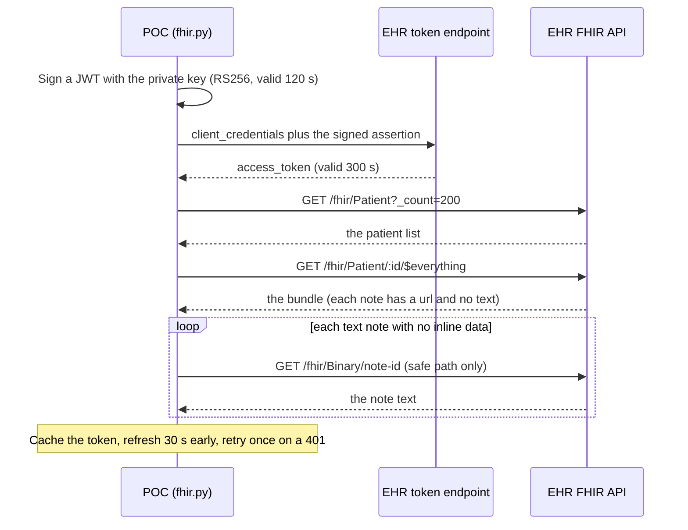

# The hospital's FHIR interface: what the POC needs to know

MediTrack (the hospital's record system) offers a read-only FHIR R4 interface. This page is everything the POC needs from it.

## 1. Addresses

| | |
|---|---|
| `POC_EHR_URL` | The address the POC calls (the sandbox address; no trailing slash needed) |
| `POC_EHR_PUBLIC_URL` | The address the EHR issues tokens for. **Must be the EHR's own public address**, exactly. If the POC calls it by another name, tokens fail. From a laptop this is the same as `POC_EHR_URL` |
| `POC_FHIR_CLIENT_ID` | The registered client name for this POC |
| `POC_FHIR_KEY_FILE` | Path to the POC's private key (PEM). Never commit it |

## 2. Getting a token (SMART backend services)

`POST {POC_EHR_URL}/smart/token`, form-encoded:

| Field | Value |
|---|---|
| `grant_type` | `client_credentials` |
| `scope` | `system/*.read` |
| `client_assertion_type` | `urn:ietf:params:oauth:client-assertion-type:jwt-bearer` |
| `client_assertion` | a JWT signed RS256 with the private key |

The assertion's claims: `iss` and `sub` both equal the client id; `aud` is `{POC_EHR_PUBLIC_URL}/smart/token`; `iat` now; `exp` now plus 120 seconds (the EHR allows at most 300); `jti` a fresh random id (an id can be used only once). JWT header `kid` is the client id.

The answer has `access_token` and `expires_in` (300). Cache the token; refresh it 30 seconds before it expires; on a 401, drop it and retry once.

The whole exchange, from token to note text:

## 3. What the POC reads

| Call | Use |
|---|---|
| `GET /fhir/Patient?_count=200` | the patient list for the picker |
| `GET /fhir/Patient/{id}/$everything` | one patient's whole chart as a bundle |
| `GET /fhir/Binary/{id}` | the text of a note (see below) |

All with `Authorization: Bearer <token>` and `Accept: application/fhir+json`.

## 4. Note text is not in the bundle

In `$everything`, each clinical note is a `DocumentReference` whose attachment has a `url` and **no inline data**. The text is at `/fhir/Binary/note-<id>`. So after `$everything`, for every DocumentReference attachment that is `text/*`, has no `data` and has a `url`:

1. Take only the **path** of the url. **Never request a URL supplied by the record.**
2. The path must match `^/fhir/Binary/[A-Za-z0-9.-]{1,128}$`; otherwise raise `FhirError('The EHR returned an unsupported note reference.')`.
3. Request that path on the configured EHR address only.
4. Reject a note larger than 256,000 bytes: `FhirError('An EHR note is too large for this POC.')`.
5. Put the text into the attachment as base64 `data`, so the same loader (`load_bundle`) reads it.

Scanned documents are PDFs with no text; the POC ignores them.

## 5. Errors the user sees (no tokens, no chart text)

| Situation | `FhirError` message |
|---|---|
| Token request failed (key unreadable, rejected, network) | `Could not authenticate the POC with the EHR. Check the service setup.` |
| A read failed | `Could not read the requested data from the EHR.` |
| Rejected twice (401 after a retry) | `The EHR rejected the POC service credentials.` |
| Patient id not matching `^[A-Za-z0-9.-]{1,64}$` | `Invalid patient identifier.` |

Use `httpx.Client(timeout=20, follow_redirects=False, trust_env=False)` by default; accept an injected client for tests.

## 6. Facts about the data that affect the summary

- Patient ids are integers as text; encounter ids are account numbers like `IP2610-0204`.
- A lab with no value yet is **pending** (the EHR marks it `registered`): show it as pending, never as a result.
- A diagnosis marked **provisional** is not confirmed.
- The same medicine can appear many times; the record de-duplicates it.
- Dates have no time zone.
- Search results are limited to 500 per page.

## 7. The sandbox clients you will be given

Ask IT (Sam Whitlock) to register your **public** key. You send only `jwks.json`; the private key never leaves your machine. `scripts/make_keypair.py` creates both.
